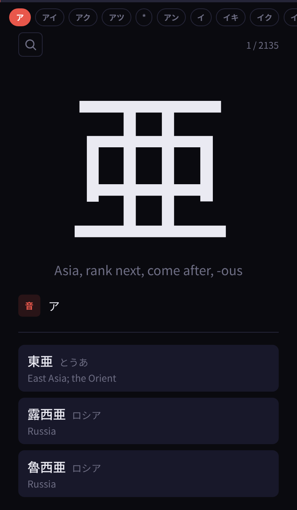

# 漢字: Jōyō Kanji Study

A phone-first web app for working through all 2,136 jōyō kanji (常用漢字) in the order of the official table: grouped by reading, so kanji that share a sound sit together.

**Live:** https://catridingeeels.github.io/kanji-app/. Add it to your home screen and it works offline.



## What it does

- Shows one kanji per card. Swipe up or down, or use the arrow keys, to move between cards.
- Follows the order of the official 常用漢字表, with a jump bar of its 352 reading groups (ア, アイ, あつかう …) along the top.
- Lists each kanji's official readings: exactly the 4,388 in the table, no more and no fewer. Okurigana is dimmed (はや**い**). Readings the table marks as special or very limited in use, like サッ in 早速, are dimmed as a whole.
- Gives up to three example words from the table itself, each with its kana and an English meaning, covering different readings where it can.
- **Parts:** tap any part of the kanji (the 氵 in 海, either 口 in 語) to highlight it and list every other jōyō kanji that contains it, with the part picked out in red in each one. Tap the same spot again to climb to the next larger part (口 → 言). Groups that aren't a character on their own, like the 冖+心+夂 under 愛 or the 日 over 大 in 暮, are parts too, drawn from the kanji itself. Tap a kanji in the list to jump to it, and the ← pill (or the phone's back gesture) brings you back. The + on each one pins it to the compare tray instead.
- Animates the stroke order from the pen button.
- **Compare:** search by kanji, meaning or reading, or add from a part's list, and pin up to two lookalikes beside the current card. They're drawn with the selected part highlighted too.
- Installs as a PWA, and a service worker caches everything for offline use.

## How it's built

**The app** is plain JavaScript, HTML and CSS with no framework and no build step: `app.js`, `index.html`, `style.css` and `sw.js`. The kanji on the card is drawn from its KanjiVG stroke paths rather than a font, which is what makes its parts tappable.

**The data** comes from three Python scripts:

- `build_joyo_table.py` turns the official 常用漢字表 PDF into `joyo_table.json`: each kanji, its old form, every reading, and the table's example words. The reading and example columns come from `pdftotext -layout`. Special readings are marked in the PDF only by a one-character indent, so their positions come from `pdftotext -bbox`. The script checks its totals against the counts the table states (2,136 kanji, 2,352 on and 2,036 kun readings) and stops if they don't match.
- `build_data.py` builds `kanji_data.json` from `joyo_table.json`:
  - It adds English meanings from KANJIDIC2 and looks up each example word in JMdict for its kana and meaning. A lookup must agree with the table's reading, so 今日 listed under コン becomes こんにち, not きょう.
  - It works out each kun reading's okurigana from the table's examples, including conjugated ones: 生い立ち gives お.う.
  - For the three example words, it picks the main on and kun readings first, then the most common of the rest.
- `build_strokes.py` pulls each kanji's stroke paths and its component breakdown out of KanjiVG. Output: `strokes.json` and `components.json`. KanjiVG groups the strokes of each kanji into named parts (`<g kvg:element="口">`), nested: 語 is 言 and 吾, 吾 is 五 and 口. The script flattens that into a list of parts with their stroke numbers, merges parts the file splits in two (the 衣 around the 口 in 哀), turns unnamed groups of two or more parts into parts of their own (keyed by their pieces, so 暮's 日-over-大 matches 募 墓 幕 慕 模 漠 膜), and drops single-stroke parts.

## Run it locally

```sh
python3 -m http.server
```

Then open http://localhost:8000. Opening `index.html` straight from disk won't work, because the app fetches its JSON files.

To rebuild the data, run `python3 build_data.py`, then `python3 build_strokes.py`. The dictionary files download into `cache/` on the first run. `joyo_table.json` is checked in, so you only need the PDF and poppler's `pdftotext` to regenerate it: `python3 build_joyo_table.py joyokanjihyo_20101130.pdf`.

## Data and credits

- **常用漢字表** (2010): Agency for Cultural Affairs (文化庁), [PDF](https://www.bunka.go.jp/kokugo_nihongo/sisaku/joho/joho/kijun/naikaku/pdf/joyokanjihyo_20101130.pdf). It's a cabinet notice (内閣告示), which Article 13 of Japan's Copyright Act leaves free of copyright.
- **KANJIDIC2** and **JMdict**: [Electronic Dictionary Research and Development Group](https://www.edrdg.org/), used under [CC BY-SA 4.0](https://www.edrdg.org/edrdg/licence.html).
- **KanjiVG**: © Ulrich Apel, [CC BY-SA 3.0](https://kanjivg.tagaini.net/).

`kanji_data.json`, `strokes.json` and `components.json` are derived from these sources and are shared under the same licenses.
